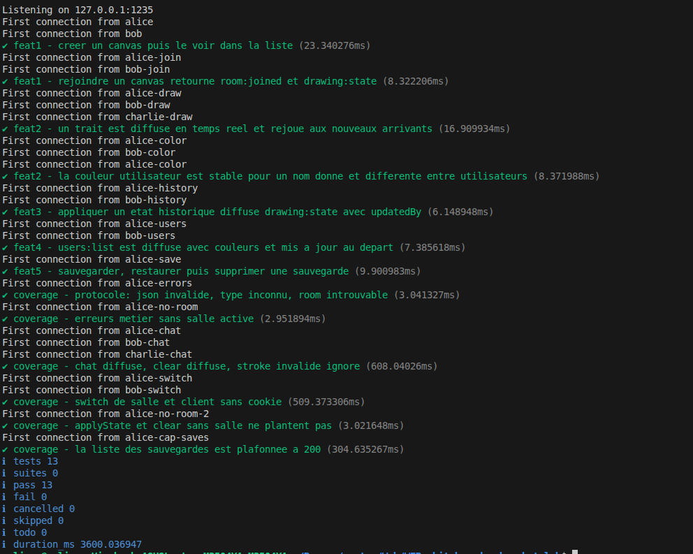

# 🎨 Whiteboard WebSocket Lab

 Ce projet est une application web de tableau blanc collaboratif en temps réel. Il permet à plusieurs utilisateurs de se connecter simultanément, de créer des salles de dessin (Canvas), de discuter et de dessiner de manière collaborative.


##  Fonctionnalités implémentées


- **Gestion des Salles (Rooms)** : Création, consultation de la liste des salles actives, et possibilité de rejoindre un dessin en cours.
- **Dessin Temps Réel** : Utilisation exclusive de l'API native `<canvas>` (HTML5) sans aucune bibliothèque externe de dessin.
- **Attribution d'Identité** : Génération d'un nom aléatoire (type distribution Ubuntu, ex: *Brave Sphere*) et d'une couleur unique persistante par utilisateur (calculée via un hash du nom).
- **Problématique résolue (Source de vérité)** : Lorsqu'un utilisateur rejoint un dessin en cours, le serveur lui envoie instantanément l'intégralité de l'historique des traits (`drawing:state`) afin qu'il puisse reconstituer le canvas avant de recevoir les nouveaux traits en temps réel.

- **Chat en direct** : Un chat textuel est intégré et isolé par salle. Chaque utilisateur ne voit que les messages de la salle dans laquelle il se trouve.
- **Liste des participants** : Affichage en temps réel des utilisateurs connectés dans la salle actuelle, avec une pastille représentant leur couleur unique.
- **Sauvegarde persistante** : Possibilité d'enregistrer l'état actuel d'un dessin. Les sauvegardes sont écrites sur le disque du serveur (`drawings-store.json`) et peuvent être restaurées ultérieurement, même après un redémarrage du serveur.
- **Mode Historique** : Interface permettant de remonter dans l'historique des traits (undo/redo), de prévisualiser l'état précédent du canvas, et de forcer la restauration à un état antérieur pour tous les participants.
- **Sécurité & Sanitization** : Le serveur valide toutes les coordonnées reçues (entre 0 et 1) pour éviter les traits corrompus ou hors-limites.

---
##  Architecture et Protocole WebSocket

Pour maintenir un code propre et lisible, le projet repose sur un système de "Routeur" de messages typés. Tous les échanges réseau se font en format **JSON**.

### Structure des messages échangés (Payloads)

Le client et le serveur utilisent des types stricts définis dans `index.ts`. Chaque message possède une propriété `type` qui définit son action.

**Exemples d'événements Client -\> Serveur :**

  - `room:create` / `room:join` / `room:leave`
  - `drawing:stroke` *(Envoi des coordonnées normalisées d'un trait tracé)*
  - `chat:send`
  - `drawing:save` / `drawing:restore`

**Exemples d'événements Serveur -\> Client :**

  - `rooms:list` *(Mise à jour de la liste du lobby via Broadcast)*
  - `drawing:state` *(Envoi de l'historique complet lors de la connexion à une salle)*
  - `drawing:stroke` *(Réception d'un trait tracé par un autre utilisateur)*
  - `users:list` *(Mise à jour du panneau des participants)*

-----

## 📂 Structure du Projet

```text
├── server.js               # Serveur Node.js gérant les WebSockets, les Rooms et la Sauvegarde
├── src/
│   ├── index.ts            # Logique client (Canvas, UI, Connexion WebSocket)
│   ├── name-generator.ts   # Utilitaire de génération de pseudonymes
│   └── index.css           # Styles globaux (Thème sombre, Layout)
├── index.html              # Point d'entrée de l'application Front-end
├── drawings-store.json     # Fichier généré automatiquement pour la persistance des dessins
├── index.test.js           # Suite de tests automatisés (couverture de code)
├── package.json            # Dépendances et scripts de lancement
└── tsconfig.json           # Configuration TypeScript
```

-----
## Stack Technique

- **Frontend** : HTML5, CSS3, TypeScript, API Canvas 2D.
- **Backend** : Node.js avec la bibliothèque `ws` (WebSockets).
- **Outillage** : Vite (Bundler), TSConfig strict, `node:test` pour les tests unitaires.

---

## 🚀 Installation & Lancement

### Prérequis
- [Node.js](https://nodejs.org/) (version 18+ recommandée)
- `npm` (inclus avec Node.js)

### Démarrage rapide

1. **Cloner le dépôt** et se placer dans le dossier :
   ```bash
   git clone <URL_DU_DEPOT>
   cd WEB-whiteboard-websocket-lab
   ```

2.  **Installer les dépendances** :

    ```bash
    npm install
    ```

3.  **Lancer l'application en mode développement** :

    ```bash
    npm run dev
    ```

    *Cette commande utilise `concurrently` pour démarrer simultanément le serveur WebSocket (sur le port `1234`) et le serveur de développement Vite (sur le port `5173`).*

4.  **Ouvrir le navigateur** :
    Rendez-vous sur [http://localhost:5173](https://www.google.com/search?q=http://localhost:5173).


##  Tests

Le projet est fourni avec une suite de tests très exhaustive (`index.test.js`) vérifiant le comportement des connexions, l'isolation des salles, la gestion de l'historique et la robustesse face aux erreurs (JSON malformés, actions sans salle, etc.).

Pour lancer les tests :

```bash
npm run test
```



---
##  Auteurs 

  - **Mermouri Melissa** 
  - **HAMAMA Hocine**


